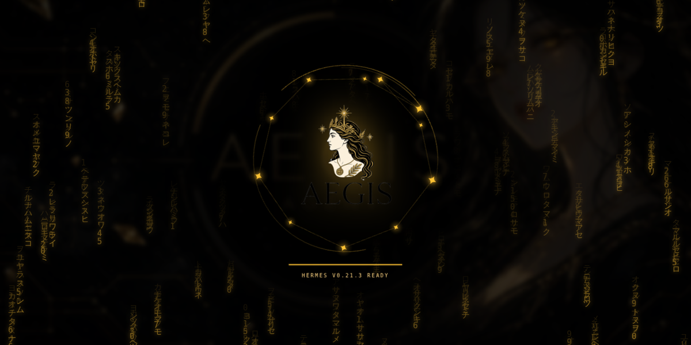
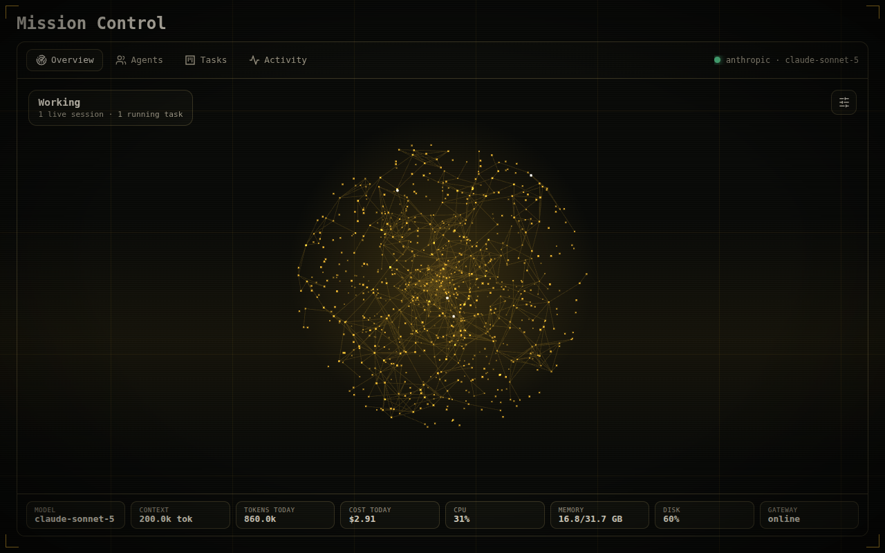
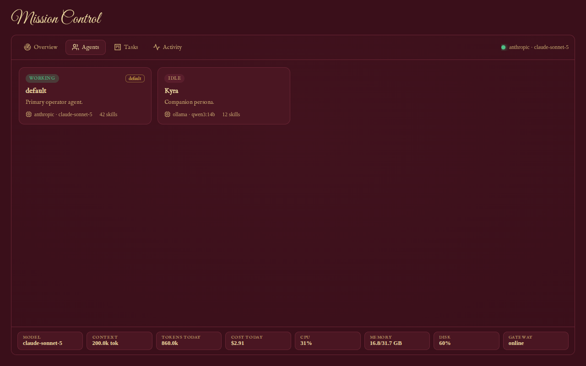
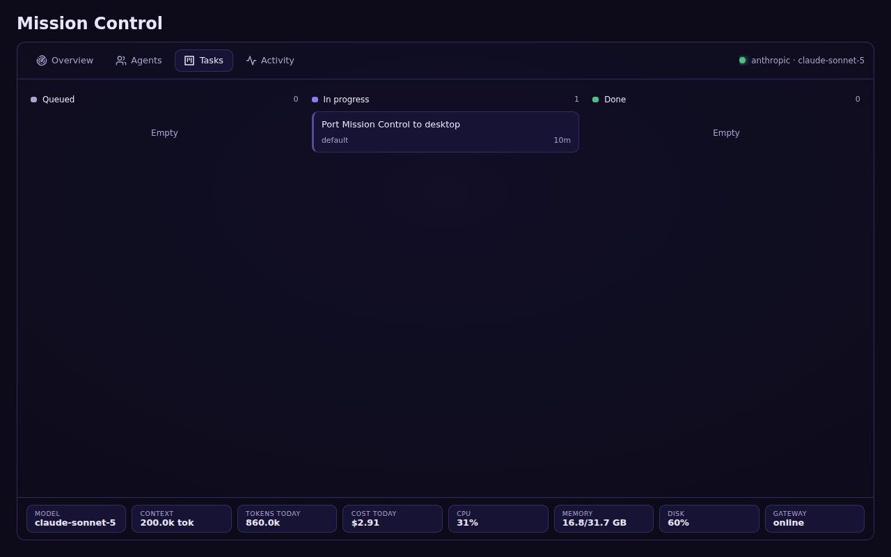
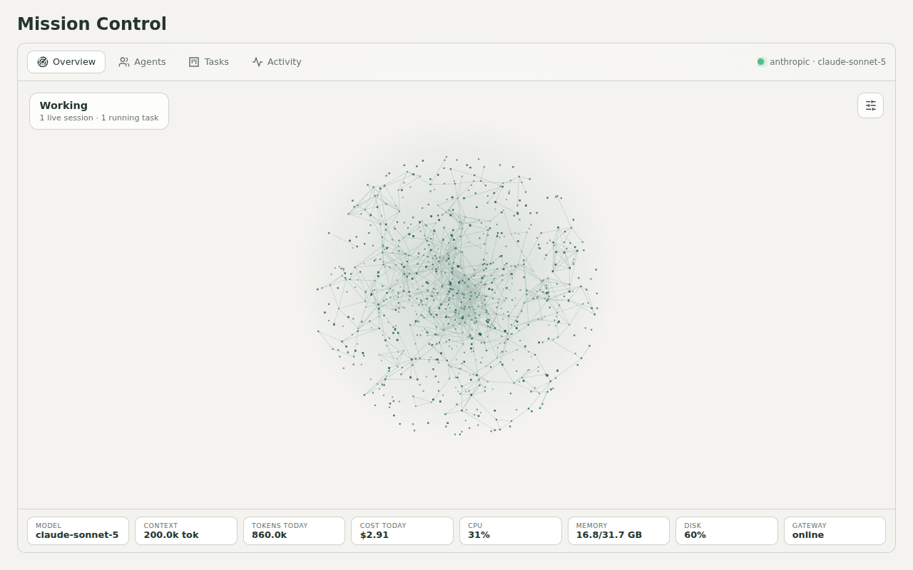

# AEGIS for Hermes



AEGIS adds a mission-control visualizer and seven themes to [Hermes Agent](https://github.com/NousResearch/hermes-agent).
It works in both the **Hermes desktop app** and the **web dashboard** (`hermes dashboard`).

- **Mission Control:** a live orb that tightens and speeds up while your agents work. It has four tabs:
  - **Agents:** your profiles, with each one's model and skill count.
  - **Tasks:** the kanban board, grouped into Queued / In progress / Done.
  - **Activity:** recent sessions.
  - **Status strip:** model, context window, tokens and cost today, CPU, memory, disk and gateway.
- **Seven themes:** Obsidian, Porcelain, Midnight, Amber (with an instrument-panel HUD), Regalia (gold on burgundy, with
  Great Vibes calligraphy), Sandstone and Nebula.
- **Boot screen:** the AEGIS emblem igniting in a constellation over matrix rain. It plays once per launch; click or
  press Esc to skip it, or turn it off in Mission Control's options.

| | |
|---|---|
|  |  |
|  |  |

## Install

```bash
hermes plugins install aegis
hermes plugins enable aegis
```

Then fully restart Hermes: quit and reopen the desktop app, or restart `hermes dashboard`. Hermes needs the restart to
load the plugin's back end, which serves Mission Control's numbers.

- **Desktop app:** Mission Control appears in the sidebar and in the command palette ("Open Mission Control"). The
  themes appear in Settings → Appearance.
- **Dashboard:** Mission Control appears as a tab. To get the themes there too, copy the theme files into your Hermes
  home folder:

  ```bash
  # macOS / Linux
  cp ~/.hermes/plugins/aegis/themes/*.yaml ~/.hermes/dashboard-themes/
  ```

  ```powershell
  # Windows
  Copy-Item "$env:LOCALAPPDATA\hermes\plugins\aegis\themes\*.yaml" "$env:LOCALAPPDATA\hermes\dashboard-themes\"
  ```

Requires Hermes 0.21 or later.

## What it touches

- **The agent:** nothing. The plugin registers no tools, hooks or middleware, so your prompts, prompt cache and
  costs are unaffected.
- **Your data:** one read-only endpoint, `GET /api/plugins/aegis/snapshot`. It reuses Hermes' own dashboard functions
  to read status, model info, host stats, recent sessions, profiles, today's usage and the kanban board. Each source
  fails on its own, so if kanban is disabled only the Tasks tab goes blank.
- **The network:** no telemetry and no outside requests, apart from Sandstone's optional Google Fonts stylesheet. The
  Regalia fonts ship inside the plugin.
- **The desktop app:** the desktop plugin (`desktop/plugin.js`) imports only `@hermes/plugin-sdk` and `react`, and
  passes Hermes' desktop-surface lint.

## Layout

```
plugin.yaml, __init__.py   Hermes plugin manifest (dashboard + desktop only; registers nothing in the agent)
dashboard/                 web dashboard plugin: manifest, built bundle (dist/), sources (src/), plugin_api.py
desktop/                   Hermes Desktop plugin: plugin.js (built), sources (src/)
shared/themes.ts           the theme definitions both surfaces are built from
themes/*.yaml              the same themes as dashboard theme files
assets/fonts/              Great Vibes and IM Fell English (SIL OFL 1.1, unmodified, licences included)
```

## Build from source

```bash
npm --prefix dashboard install
npm --prefix dashboard run build      # dashboard/dist/index.js + style.css (WebGL orb, three.js bundled)
node desktop/build.mjs                # desktop/plugin.js (canvas orb, no three.js)
```

The built files are committed so installs never need a build step.

## Licence

MIT © WRATH815. Great Vibes and IM Fell English are under the SIL Open Font License 1.1 (licence files in
`assets/fonts/`). three.js (bundled in the dashboard build only) is MIT.
